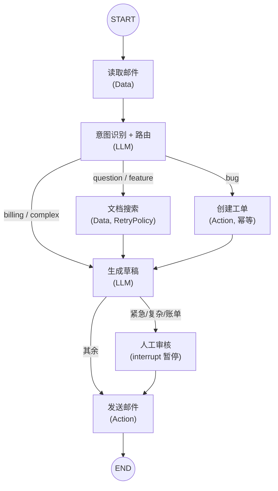

# Email Support Agent — 基于 LangGraph 的客户支持邮件 Agent

> 课程来源：《Langchain和LangGraph入门到实战》第5章第3节 *Think In LangGraph*。
> 本项目将课程 notebook 工程化为标准 Python 包（src 布局 + uv 管理 + 单元测试 + CLI 交互）。

## 项目简介

自动处理客服邮件的 Agent：读取邮件 → LLM 意图识别与分类 → 按意图分流（查文档 / 建工单）→ 生成回复草稿 → 紧急或敏感问题转人工审核 → 发送回复。

**核心思想：Think In LangGraph 五阶段**

1. 将任务拆解为离散的节点（Node）
2. 明确每个节点的具体任务
3. 设计节点间流转的数据格式（State）
4. 编写节点函数，做好异常处理
5. 连接节点形成图（Graph）

与传统 Prompt Chaining（线性 A→B→C）不同，真实世界的 Agent 是**有分支、有回路、有人工介入的图结构**。

## 架构



**路由不靠条件边**：每个决策点的节点内部通过 `Command(goto=...)` 声明下一跳，图上只保留 4 条固定边（最小边原则），结构极简。

## 节点职责（四类节点）

| 节点 | 类型 | 职责 | 失败策略 |
|------|------|------|----------|
| `read_email` | Data | 解析邮件原始信息 | 读取失败重试；不完整告警人工 |
| `classify_intent` | LLM | 结构化分类 + 路由决策 | 解析失败兜底为 complex 转人工 |
| `search_documentation` | Data | 检索知识库 | RetryPolicy 自动重试；耗尽后降级空结果 |
| `bug_tracking` | Action | 创建 Bug 工单 | 工单号由 email_id 哈希生成，天然幂等 |
| `draft_response` | LLM | 生成草稿 + 判断是否需审核 | 生成失败重试；内容异常转人工 |
| `human_review` | Human | interrupt 暂停等待审批 | edit 更新草稿；长时间无响应升级 |
| `send_reply` | Action | 发送回复邮件 | 发送失败重试；仍失败告警人工 |

## State 设计原则

> 下游节点需要用它做决策、无法从其他字段推导、重新获取成本高的信息才入 State。

| 分类 | 字段 | 入选理由 |
|------|------|----------|
| 原始输入 | `email_content` / `sender_email` / `email_id` | 之后无法重建 |
| 分类结果 | `classification` | 被多个下游节点使用 |
| 外部数据 | `search_results` / `customer_history` | 重新获取成本高 |
| 生成内容 | `draft_response` | 人工审核期间需展示 |

## 快速开始

```bash
# 1. 安装依赖（uv 管理）
uv sync

# 2. 配置 API Key
cp .env.example .env   # 填入你的 DEEPSEEK_API_KEY

# 3. 运行三个场景演示（人工审核在终端交互）
uv run main.py

# 4. 运行单元测试（无需 API Key）
uv run pytest
```

三个演示场景覆盖三条路径：

| 场景 | 邮件 | 路径 |
|------|------|------|
| 1 普通问题 | 忘记密码重置 | 分类 → 查文档 → 自动回复（全程无人工） |
| 2 Bug 报告 | PDF 导出崩溃 | 分类 → 建工单 → 草稿 → **人工审核** |
| 3 紧急账单 | 重复扣款 | 分类 → 草稿 → **人工审核**（edit 示例） |

人工审核面板支持两种操作：`approve`（原稿直接发送）、`edit`（多行输入修改稿，`END` 结束）。

## 项目结构

```
email-support-agent/
├── src/email_agent/
│   ├── state.py          # State + 分类结构（TypedDict）
│   ├── routing.py        # 路由决策纯函数（可单测）
│   ├── llm.py            # LLM 惰性初始化（无 Key 可测）
│   ├── nodes/            # 7 个节点，一节点一文件
│   └── graph.py          # 图组装（最小边 + RetryPolicy + checkpointer）
├── main.py               # CLI 演示（三场景 + 交互式审核）
├── tests/test_routing.py # 路由/幂等/图结构单测（不调 LLM）
├── pyproject.toml        # uv + hatchling
└── .env.example
```

## 核心知识点（面试向）

| 技术点 | 说明 |
|--------|------|
| `Command(goto=...)` | 路由决策写在节点内部而非条件边，图只需最小边；`update` 同时写 State |
| `with_structured_output` | LLM 输出约束为 `EmailClassification` 结构化类型，配合兜底逻辑保证健壮性 |
| `RetryPolicy` | 节点级自动重试（指数退避），只挂易失败的 Data 节点 |
| `interrupt` + checkpointer | Human-in-the-loop：图暂停、外部收集决策、`Command(resume=...)` 恢复 |
| 异常分类处理 | 可重试异常→RetryPolicy；LLM 输出异常→结构化约束+兜底；业务异常→降级/转人工；不可恢复→END+告警 |
| 幂等性设计 | Action 节点（建工单）用确定性 ID 生成，重复执行结果一致 |

## 可扩展方向

- [ ] 知识库检索替换为真实 RAG（向量库 + 重排）
- [ ] 邮件收发接入 IMAP / SMTP
- [ ] LangSmith 追踪与 Agent Evals
- [ ] FastAPI 服务化 + 前端审核界面
- [ ] checkpointer 换持久化存储（Postgres/Redis），支持跨会话审核

## 更多资源

- [LangGraph 官方文档](https://langchain-ai.github.io/langgraph/)
- [LangGraph GitHub](https://github.com/langchain-ai/langgraph)
